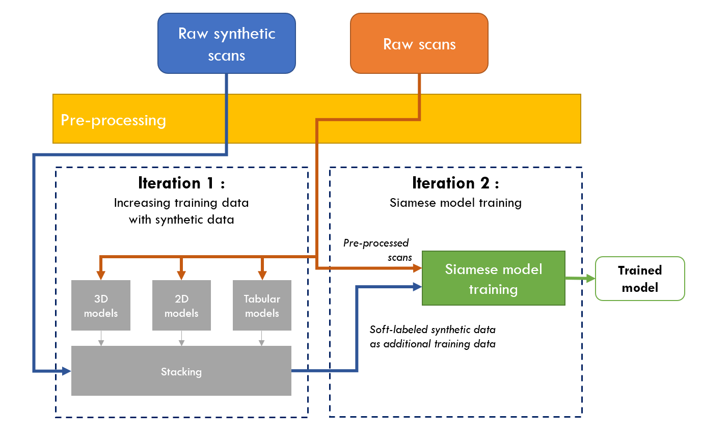
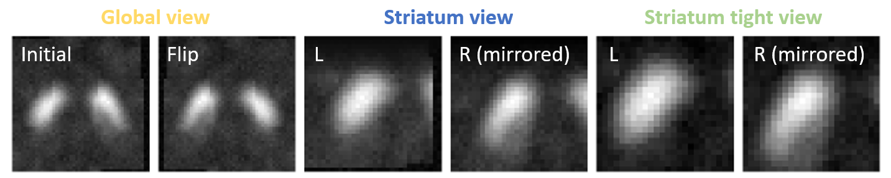

# Solution - DaT Parkinson's challenge
**Team**: TheAvengers <br>
**Usernames**: `dvtle`, `SamuelAnsel`

## Summary
Our approach relies on the hypothesis that the main geometric anomaly associated with Parkinsonian syndromes is the **asymmetry between the left and right parts of the striatum**.
To this end, the data processing pipeline is designed to isolate the striatum through a tight crop of the scans, followed by its separation into left and right components. 
This data is then passed through a Siamese neural network which further captures the symmetry or asymmetry of the striatum.
This Siamese network is also trained with additional synthetic data.

### Approach overview
The full process relies on two blocks: (1) synthetic data soft-labeling which is then used as supplementary training data to (2) train a Siamese model to predict the actual scans. 



### External data
We are using synthetic external data of DaT PET scans from [Won et al.](https://www.sciencedirect.com/science/article/pii/S2666379125002800?via%3Dihub) Despite PET scans being different from SPECT scans, as PET scans have a better resolution, we found that adding them to the training data is beneficial. They are also preprocessed with exactly the same preprocessing steps, so no additionnal complexity is added.

### Two steps

We started the competition by experimenting with a lot of models (3D, 2D, features...) and stacking them, this ended up being the first iteration used to soft label the synthetic dataset before moving on the siamese architecture.

### Ensembling

Iteration 1 training scripts are using 5 folds CV. We later found that we had a lot of noise between runs using different seeds. So we augmented the number of models trained to 100 with 20x5 folds training, in order to lower the variance of our experiments. We ended up using 20 models for validation set and 100 for inference.


## Hardware and time
**Tested environment:**
- CPU: Intel(R) Xeon(R) 6517P @ 3.20GHz (16 cores)
- GPU: 2 x RTX PRO 6000 Blackwell Server Edition (VRAM: 2 x 96GB)
- Memory (GB): 512 GB RAM
- OS: Ubuntu 26.04 LTS
- Python: 3.12.13

**Processing times:**
- Block 1 (synthetic data soft labeling):
	- Model trainings: estimated 3.5 days for all twelve models sequentially (about 7h per model)
	- Synthetic data soft-labeling: 1h
- Block 2 (siamese model training): about 30 minutes

## Setup

### Installation

We use uv and the pyproject.toml file to setup the environnement, run this command to make install dependencies in a .venv.
```bash
uv sync
```

### Data setup

Before running any command, make sure your data folder has been set to the correct path in the configuration file : `root_dir` should be the root directory of your data.

This `root_dir` should initially look like :

```text
<root_dir>
├── niftis # Folder with nii.gz files.
└── train_labels_JNDlMjr.csv
```

At the top of the config file you should have :
```yaml
paths:
  root_dir: "<path_to_your_data_folder>"

  ...
```

### External data

Then you should download external data from https://github.com/Krying/PD_SSL_ZOO (look for One Drive/Synthetic FP-CIT-PET Samples) and put them in a directory named `external` in the `root_dir`

```text
<root_dir>
├── external
│   └── PET_GENERATED   # Folder with nii.gz synthetic PET files.
├── niftis              # Folder with nii.gz files.
└── train_labels_JNDlMjr.csv
```

> **_NOTE:_**  Using external data is eventually optional, look into the pipelines commands later in this README to skip them.

### Model weights setup
It is possible to skip the train steps of each phase by downloading our model weights.

A utilitary script is available to simplify this process :

```bash
python scripts/download_weights
```

It will make a copy of your current results folder if they exists, and place each weight in its corresponding folder.

Then you can skip any part of the pipeline

## Pipeline Execution

The training pipeline is fully automated and orchestrated by `5_pipeline/run_pipeline.py`. It is divided into logical phases that can be run end-to-end or resumed from specific checkpoints.

### Pipeline Phases
1. **Phase 1 (Prep & Teachers):** Prepares cross-validation folds, extracts 2D datasets, and trains the ensemble of base models (ResNets, MedicalNets, SVM) defined in the config.
2. **Phase 2 (Stacking):** Gathers Out-Of-Fold (OOF) predictions from Phase 1 and trains a Meta-Model to find the optimal consensus.
3. **Phase 3 (Soft Labeling):** Uses the Phase 1 ensemble + Phase 2 Meta model to generate  soft labels for the unannotated synthetic dataset.
4. **Phase 4 (Siamese):** Prepares training data patches (Striatum crops) and trains the final Siamese network using both real and soft-labeled synthetic data.
5. **Pack for production:** Executed via `6_runtime/pack_production.py`, this step automatically gathers the final weights, synchronizes the `src/` folder, creates the `.zip` archives, and triggers the local Docker evaluation.

### Running the Pipeline
To run the full training pipeline from end-to-end:
```bash
python 5_pipeline/run_pipeline.py
```

### Resuming / Skipping Phases

The pipeline uses sequential checkpointing. You can start the execution from any specific phase using the `--start-at` argument. The script will automatically skip all preceding steps.

| Target Action | Command to Run | Comment |
|---|---|---|
| **Run Everything** | `python run_pipeline.py` | Prepare data and train every model from scratch|
| **Start from Phase 1 Training** | `python run_pipeline.py --start-at phase1_train` | |
| **Start from Stacking (Phase 2)** | `python run_pipeline.py --start-at phase2` | You need to have trained weights in phase1 results directory |
| **Start from Soft Labeling (Phase 3)** | `python run_pipeline.py --start-at phase3` | |
| **Start from Siamese Prep (Phase 4)** | `python run_pipeline.py --start-at phase4_prep` | You can start from here with the soft label .csv and synthetic data, no other weights needed|
| **Run Siamese Training Only** | `python run_pipeline.py --start-at phase4_train` | |

#### Alternative 1: Soft labeling with only 3 models

Initially, we used 13 models (12 neural nets and 1 svm) to soft label the synthetic data. We found that you can reproduce almost the same results by only training 2 neural nets and the SVM. To do so, just modify the stacking section of the config file, and run the pipeline from scratch.

```yaml
stacking:
  tabular_oof: "${paths.phase1_out}/${models.SVM.folder}/tabular_oof.csv"
  
  active_models:
    - ResNet2D
    - MedicalNet50    
```

> **_NOTE:_**  With this setup, it does not technically reproduce our best submission, but get very close results.

#### Alternative 2: Train without external data

To train the Siamese model using exclusively the real dataset, simply append the `--no-synth` flag. The orchestrator will automatically skip phases 1 to 3, prepare only the real data tensors, and run the training script without the synthetic data.

```bash
python 5_pipeline/run_pipeline.py --no-synth
```

> **_NOTE:_**  With this setup, it does not reproduce our best submission.

### Pack for submission

By running the following command : 
```bash
python 6_runtime/pack_production.py
```

It will pack src code and weights for submission and launch a smoke test in a container. Once done, you can pick the `submission.zip` in `<project-dir>/competition-sfmn-parkinsons-runtime/submission`

### Running inference

To run the inference locally, run the following command:

```bash
python competition-sfmn-parkinsons-runtime/submission_src/main.py
```

By default it will infer nii.gz files in `data/niftis`

## Key features

### Data pre-processing

Based on our hypothesis that most of the relevant information is contained within the striatum, we represent the provided 3D scans using close 2D views of the striatum and using Maximum Intensity Projection (MIP) on the axial dimension. 
More specifically, the models are provided with 3 views: a global view of the striatum (initial and flip), one view of each side considered independently, and one close-up view of each side, as illustrated below.



### Block 1 - Synthetic data soft labeling

A [synthetic dataset](https://zenodo.org/records/15377683) of DaT PET scans is used to increase the amount of training data. 
The corresponding labels are soft labels generated by an ensemble of models trained on the real dataset.

- **Model architectures:**
    - DenseNet 3D (121, 121+attention and 201 layers)
    - Medicalnet 3D - backbone ResNext (50 and 101 layers)
    - Medicalnet 3D - backbone ResNet (18, 34, 50, and 200 layers)
    - MedNext Base
    - ResNet 2D
    - ViT 2D
    - SVM
- **Ensemble:** Linear combination of:
  - Logistic Regression
  - Bag ensembling


### Block 2 - Siamese model

**Model architecture -** 
Three light encoders, each consisting of a 4-layer CNN, for a total of 1.9M parameters, are used to process the individual views.

**Training procedure -**
Because the resulting model is highly sensitive to the choice of folds, particularly given the small size of the training dataset, we repeat the training procedure using different shuffles of the folds. 
Specifically, we perform the 5-fold training procedure over 20 independent runs, resulting in a total of 100 trained models. 
At inference time, predictions on the test set are obtained by averaging the predictions from all 100 models.


## Developer notes

### Remaining errors in the last submission
**Incorrect horizontal flip in data augmentation -**  In `1_initial_training/train_2d_resnet.py` (line 58) and `1_initial_training/train_2d_vit.py`, the data augmentation transforms include a `transforms.RandomHorizontalFlip(p=0.5)`.
Due to a coordinate mismatch, this transformation currently performs a top-down flip rather than the intended left-right flip. Fixing it should make the augmentation behave as expected and may improve model performance.

### Soft labeling of synthetic data
Another bug lies in the soft labeling, initially synthetic data were upside down when compared with the competition data. We did not catch that up until after the deadline. Fortunately the previous bug cancelled this one, since some models learned to predict upside down.

We kept the bug in order to reproduce our best submission results, but there is room for improvement here.

### Reproducibility difference
We retrain the models from scratch and compare their results with those of the original submission to evaluate the stochastic effects of the training process.

Regarding the first block, we evaluated two training setups: (1) retraining all 12 models (~3.5 days), and (2) retraining only three models (ResNet2D, MedicalNet50, and SVM) to reduce the computational cost. These two setups resulted in different sets of soft labels. For the second block, we used the same Siamese architecture and repeated the training procedure over 100 runs as described above.

The resulting out-of-fold results are as follows:

| Model                    | Log loss (avg) | Log loss (std) | AUC (avg) | AUC (std) |
|--------------------------|----------------|----------------|-----------|-----------|
| Submission (12 models)   | 0.2000         | 0.0119         | 0.9758    | 0.0032    |
| Reproduction (12 models) | 0.2010         | 0.0119         | 0.9754    | 0.0032    |
| Reproduction (3 models)  | 0.2014         | 0.0119         | 0.9755    | 0.0032    |


## Resources and acknowledgements
- Block 1 - Synthetic data soft labeling:
  - MedicalNet: https://github.com/Tencent/MedicalNet
  - ResNeXt backbone for MedicalNet: https://github.com/kenshohara/3D-ResNets-PyTorch
  - MedNeXt: https://github.com/MIC-DKFZ/MedNeXt
  - Synthetic data : https://zenodo.org/records/15377683
  - Resnet 50 pre-trained weights: https://huggingface.co/edadaltocg/resnet50_cifar100
  - ViT pre-trained weights: https://huggingface.co/edadaltocg/vit_base_patch16_224_in21k_ft_cifar100
- Block 2 - Siamese model : no additional used resources

## License
These materials are shared solely for the verification process related to the challenge and should not be used, reproduced, distributed, disclosed, or shared with any third party, except with those directly involved in the evaluation process and only where necessary to assess our submission.

If you need or would like to share any of these materials with a third party during the review process, please let us know in advance.
