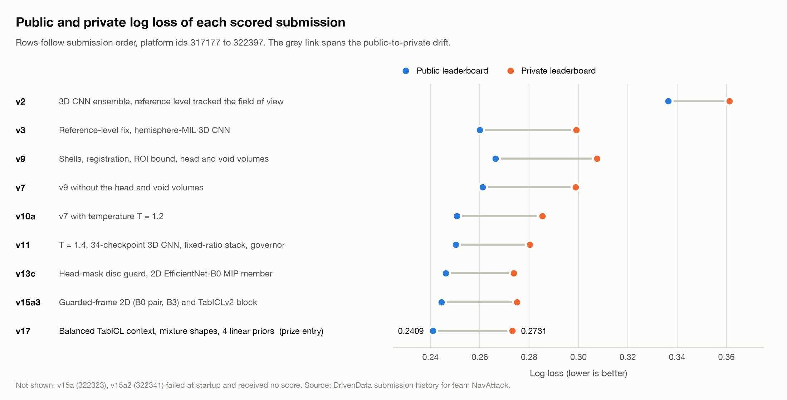
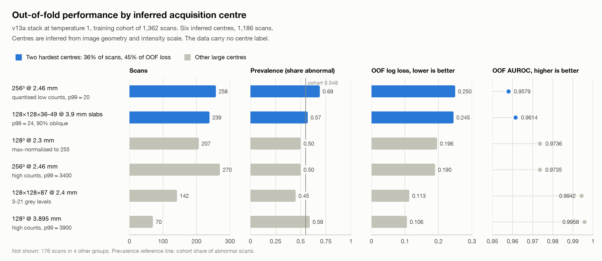
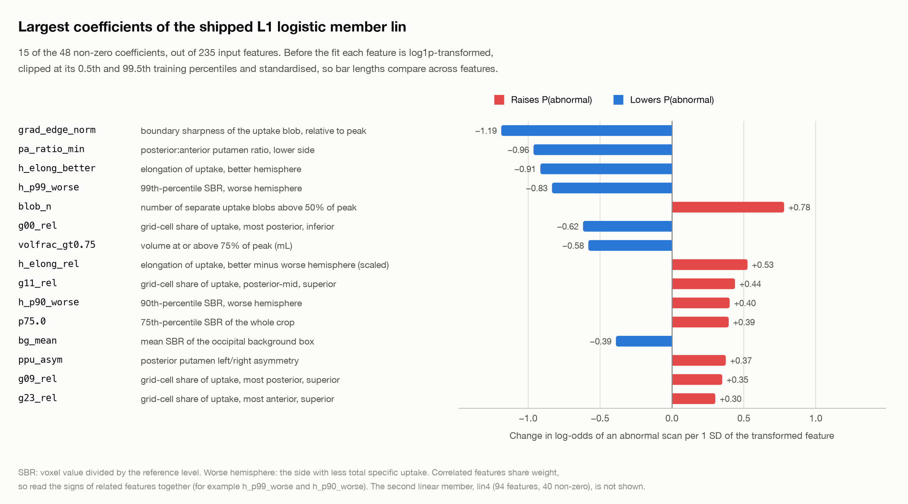
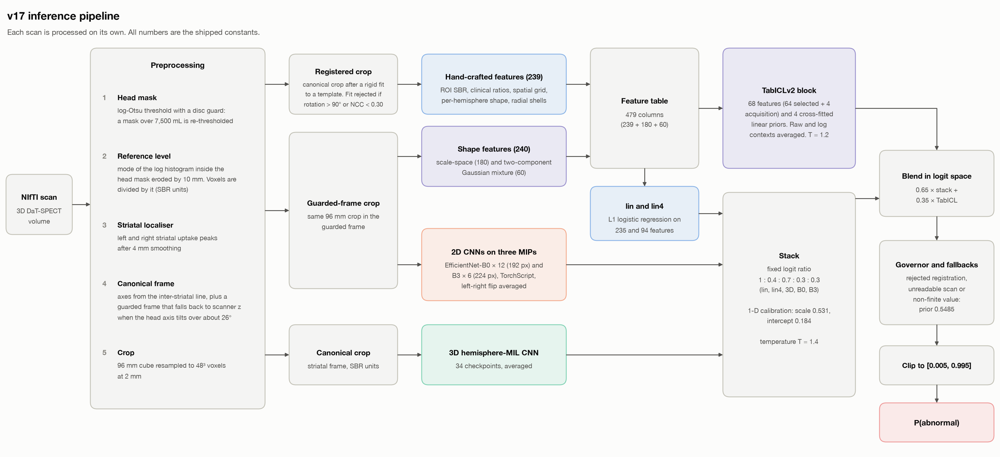
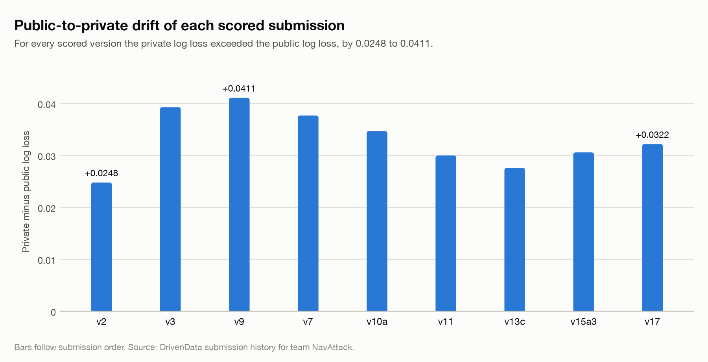

# Figures

These five figures illustrate question 4 of the solution write-up and the repository documentation. `make_figures.py` draws all of them. It takes every plotted number from a constant typed into the script. Each constant carries a comment that names its source: a file of this repository or of the installed weights, or the author's development notes (not distributed). The coefficient chart reads the shipped model file `linear_lin.json`. No figure uses a per-scan value.

## Regeneration

From the repository root, after `scripts/install_weights.py` has installed the model files:

```bash
python docs/figures/make_figures.py --assets inference/assets
python docs/figures/make_figures.py --print-tables   # prints the data tables below
```

The script needs matplotlib. I ran it with Python 3.12.11 and matplotlib 3.11.1. Without `inference/assets/linear_lin.json` it skips `lin_coefficients.png` and draws the other four figures.

## 1. Score progression



`score_progression.png` shows the public and private log loss of the nine scored submissions, in submission order (platform ids 317177 to 322397). Blue dots mark the public leaderboard and orange dots the private leaderboard. The grey link between the two dots spans the public-to-private drift. Each row carries a one-line summary of what that version added. v17, the prize entry, scored 0.2409 public and 0.2731 private. Two further uploads, v15a (322323) and v15a2 (322341), failed at startup and received no score, so the chart leaves them out. Source: the DrivenData submission history for team NavAttack.

| Version | Submission id | Public log loss | Private log loss | Drift | Change |
|---|---:|---:|---:|---:|---|
| v2 | 317177 | 0.3364 | 0.3612 | +0.0248 | 3D CNN ensemble, reference level tracked the field of view |
| v3 | 317209 | 0.2599 | 0.2992 | +0.0393 | Reference-level fix, hemisphere-MIL 3D CNN |
| v9 | 317758 | 0.2664 | 0.3075 | +0.0411 | Shells, registration, ROI bound, head and void volumes |
| v7 | 319837 | 0.2611 | 0.2988 | +0.0377 | v9 without the head and void volumes |
| v10a | 319839 | 0.2507 | 0.2854 | +0.0347 | v7 with temperature T = 1.2 |
| v11 | 319842 | 0.2502 | 0.2802 | +0.0300 | T = 1.4, 34-checkpoint 3D CNN, fixed-ratio stack, governor |
| v13c | 321081 | 0.2462 | 0.2738 | +0.0276 | Head-mask disc guard, 2D EfficientNet-B0 MIP member |
| v15a3 | 322345 | 0.2444 | 0.2750 | +0.0306 | Guarded-frame 2D (B0 pair, B3) and TabICLv2 block |
| v17 | 322397 | 0.2409 | 0.2731 | +0.0322 | Balanced TabICL context, mixture shapes, 4 linear priors |

## 2. Out-of-fold performance by inferred acquisition centre



`family_loss.png` shows, for six inferred acquisition centres of the 1,362-scan training cohort (1,186 scans), the scan count, the share of abnormal scans, the out-of-fold (OOF) log loss and the OOF AUROC. The OOF predictions come from the v13a stack at temperature 1, an earlier stack than v17. I inferred the centres from image geometry and raw intensity scale, and each is one geometry family at one intensity scale. The data carry no centre label, and I have not verified that a centre corresponds to one hospital. Blue marks the two hardest centres, which together hold 36% of the cohort's scans (497) and 45% of its OOF loss. The vertical line in the prevalence panel marks the cohort share of abnormal scans, 0.548. The chart leaves out 176 scans in four other groups. Source: aggregate OOF statistics from my development notes.

| Inferred centre | Scans | Prevalence | OOF log loss | OOF AUROC |
|---|---:|---:|---:|---:|
| 256³ @ 2.46 mm, high counts, p99 ≈ 3400 | 270 | 0.50 | 0.190 | 0.9735 |
| 256³ @ 2.46 mm, quantised low counts, p99 ≈ 20 | 258 | 0.69 | 0.250 | 0.9579 |
| 128³ @ 3.895 mm, high counts, p99 ≈ 3900 | 70 | 0.59 | 0.106 | 0.9958 |
| 128×128×36-49 @ 3.9 mm slabs, p99 ≈ 24, 90% oblique | 239 | 0.57 | 0.245 | 0.9614 |
| 128³ @ 2.3 mm, max-normalised to 255 | 207 | 0.50 | 0.196 | 0.9736 |
| 128×128×87 @ 2.4 mm, 3-21 grey levels | 142 | 0.45 | 0.113 | 0.9942 |

Every row aggregates 70 or more scans. The centres are inferred from image geometry and intensity scale, and none is named.

## 3. Coefficients of the linear member lin



`lin_coefficients.png` shows the 15 largest coefficients, by absolute value, of `lin`, the L1-regularised logistic regression in the v17 stack. `lin` reads 235 hand-crafted features and keeps 48 non-zero coefficients. Before the fit, `FeatPrep` in `inference/portable3.py` log1p-transforms each feature, clips it at its 0.5th and 99.5th training percentiles and standardises it. Each coefficient is therefore the change in log-odds of an abnormal scan per standard deviation of the transformed feature, and bar lengths compare across features. Red bars raise the predicted probability of an abnormal scan and blue bars lower it.

SBR is the voxel value divided by the reference level. The worse hemisphere is the side with less total specific uptake. The spatial grid splits a 22 × 32 × 18 mm box around each striatum into 3 × 4 × 2 cells, and a `g.._rel` feature gives the share of total grid uptake in one cell. The fit trades weight between correlated features, so the signs of related features such as `h_p99_worse` and `h_p90_worse` only make sense read together. The chart omits the second linear member, `lin4` (94 features, 40 non-zero). Source: the shipped model file `linear_lin.json`.

| Rank | Feature | Meaning | Coefficient |
|---:|---|---|---:|
| 1 | `grad_edge_norm` | boundary sharpness of the uptake blob, relative to peak | -1.187 |
| 2 | `pa_ratio_min` | posterior:anterior putamen ratio, lower side | -0.962 |
| 3 | `h_elong_better` | elongation of uptake, better hemisphere | -0.915 |
| 4 | `h_p99_worse` | 99th-percentile SBR, worse hemisphere | -0.834 |
| 5 | `blob_n` | number of separate uptake blobs above 50% of peak | +0.780 |
| 6 | `g00_rel` | grid-cell share of uptake, most posterior, inferior | -0.618 |
| 7 | `volfrac_gt0.75` | volume at or above 75% of peak (mL) | -0.581 |
| 8 | `h_elong_rel` | elongation of uptake, better minus worse hemisphere (scaled) | +0.526 |
| 9 | `g11_rel` | grid-cell share of uptake, posterior-mid, superior | +0.439 |
| 10 | `h_p90_worse` | 90th-percentile SBR, worse hemisphere | +0.401 |
| 11 | `p75.0` | 75th-percentile SBR of the whole crop | +0.395 |
| 12 | `bg_mean` | mean SBR of the occipital background box | -0.389 |
| 13 | `ppu_asym` | posterior putamen left/right asymmetry | +0.374 |
| 14 | `g09_rel` | grid-cell share of uptake, most posterior, superior | +0.350 |
| 15 | `g23_rel` | grid-cell share of uptake, most anterior, superior | +0.302 |

## 4. Inference pipeline



`pipeline_diagram.png` (vector copy: `pipeline_diagram.svg`) shows how v17 turns one NIfTI scan into a probability. Preprocessing builds a log-Otsu head mask with a disc guard and sets the reference level to the mode of the log histogram inside the head mask eroded by 10 mm. It then locates both striata, derives a canonical frame and resamples a 96 mm crop to 48³ voxels at 2 mm.

Three crops leave preprocessing. The registered crop, the canonical crop after a rigid fit to a template, yields 239 hand-crafted features. The two L1 logistic members `lin` and `lin4` read 235 and 94 of them. The canonical crop feeds the 3D hemisphere-MIL CNN, averaged over 34 checkpoints. The guarded-frame crop feeds three maximum-intensity projections to 12 EfficientNet-B0 and 6 EfficientNet-B3 TorchScript models, and it also yields 240 scale-space and Gaussian-mixture shape features.

The stack weights the five member logits at the fixed ratio 1 : 0.4 : 0.7 : 0.3 : 0.3, applies a fitted scale of 0.531 and an intercept of 0.184 (a 1-D calibration) and divides the result by T = 1.4. The TabICLv2 block reads 68 columns of the 479-column feature table plus 4 cross-fitted linear prior scores, averages a raw and a log context and divides its logit by T = 1.2. The final logit is 0.65 × stack + 0.35 × TabICL. Scans with a rejected registration, an unreadable file or a non-finite output receive the training prior 0.5485. The last step clips every probability to [0.005, 0.995]. Source: the shipped code in `inference/` and the constants in `inference_config.json` and `tabular_recipe.json`.

## 5. Public-to-private drift



`drift.png` shows the private minus the public log loss for each scored submission, in submission order. Every version scored worse on the private slice, by 0.0248 (v2) to 0.0411 (v9). v17 drifted by 0.0322. The table under figure 1 lists all nine values. Source: the DrivenData submission history for team NavAttack.
